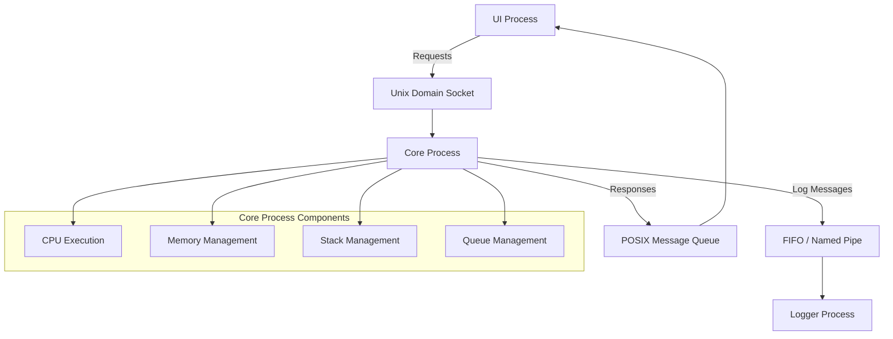

# Multi-Process Simulator – Architectural Diagram

## Architecture Overview

The Multi-Process Simulator consists of three independent processes: UI Process, Core Process, and Logger Process. They communicate using three Inter-Process Communication (IPC) techniques.

- **UI Process:** Accepts user input, sends requests, and displays results.
- **Core Process:** Executes operations and manages CPU execution, memory, stack, and queue.
- **Logger Process:** Receives and displays execution logs.
- **Unix Domain Socket:** Transfers requests from the UI to the Core.
- **POSIX Message Queue:** Transfers responses from the Core to the UI.
- **FIFO (Named Pipe):** Transfers log messages from the Core to the Logger.

## Architectural Diagram

## Working Flow

1. The user selects an operation from the UI menu.
2. The UI sends the request to the Core Process through a Unix Domain Socket.
3. The Core Process executes the requested operation using its CPU, memory, stack, or queue components.
4. The Core Process sends the result or status to the UI through a POSIX Message Queue.
5. The Core Process sends execution logs to the Logger Process through a FIFO (Named Pipe).
6. The UI displays the operation result, and the Logger displays execution details.

## IPC Techniques Used

| IPC Technique | Communication | Purpose |
|---|---|---|
| Unix Domain Socket | UI → Core | Transfers operation requests |
| POSIX Message Queue | Core → UI | Transfers results and responses |
| FIFO (Named Pipe) | Core → Logger | Transfers execution logs |
